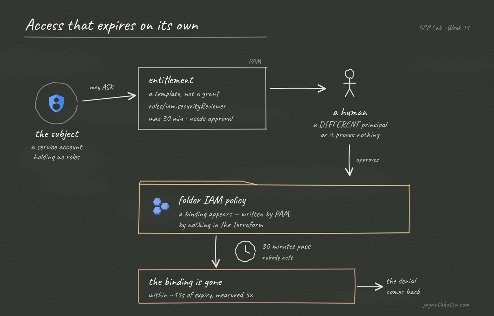

# Sketchnote diagram style — prototype

**Not adopted yet.** This is a sample for review, not something any published
post uses. Nothing here is referenced by the blog.



Open `week-11-sample.svg` directly for the real thing — the PNG above is a
flattened copy for GitHub, and the handwriting font only renders where the page
supplies it.

## What it is

A chalkboard rendering of a week's architecture: board, handwriting, hand-drawn
arrows, drawn figures, and official Google Cloud product icons.

## The rule that shapes it

Google's icon terms permit **resizing and repositioning** their marks and
nothing else — no filter, no recolour, no compositing. So:

- **Google products** use the official icon, untouched. Here: Identity and
  Access Management, and Project.
- **Everything else is drawn** — the person, the folder, the clock, the frames,
  the arrows, the wiped-chalk patches.

That split is not a workaround, it is what the reference style actually does,
and it solves a real problem: there is no official Privileged Access Manager
icon, so "entitlement" has to be a drawn box. In this style that reads as the
house style rather than as a gap.

## Reproducing it

```bash
python docs/diagram-style/render_sketch_diagram.py
```

Self-contained. It downloads Google's official icon library on first run and
caches it in `.icon-cache/`, which is gitignored — **the library is not
vendored**. The terms cover using the marks in a diagram; redistributing a copy
of their icon set in a public repo is a different question, and not one this
repo needs to answer.

Output is deterministic: the random "wobble" that makes lines look hand-drawn
is seeded, so the same input always produces a byte-identical SVG. A diagram
that changed every time it was regenerated could not be reviewed in a diff.

## Known rough edges

- The folder tab is drawn slightly wrong.
- Dead space to the right of the subject.
- The chalk texture could be stronger.

All layout, none of them a reason to reject the approach.

## Open questions

1. **Retrofit scope.** Week 12 onward only, or back over the eleven published
   weeks? Weeks 02 and 04 would gain most — their diagrams carry real
   explanatory weight.
2. **Light mode.** The site has both themes. A dark slate in light mode is a
   deliberate "here is the blackboard" moment, or there could be a paper-and-ink
   variant.

## The constraint that is not negotiable

Designed at ~1280px with large text, so it stays legible on a phone **without**
tapping to zoom. At 390px a 1600px-wide diagram scales to 0.22×, which turns a
22px label into 4.9px. The reference images are desktop-first; these cannot be.
That is why they carry fewer elements.
